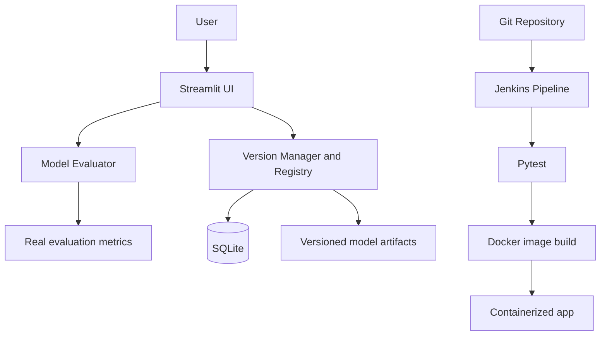

# ModelVault — Model Versioning and Management System

Educational mini-project demonstrating genuine ML evaluation, version history, comparison, Jenkins CI, and Docker.

## Features
- Upload trusted `.pkl` / `.joblib` models and a labelled CSV test dataset.
- Classification metrics: accuracy, macro precision, macro recall, macro F1, confusion matrix.
- Regression metrics: MAE, RMSE, R².
- SQLite metadata registry, versioned artifact folders, version comparison, production-version marking.
- Jenkins tests and Docker image build.

## Run on Windows
```powershell
py -3.11 -m venv .venv
.\.venv\Scripts\Activate.ps1
python -m pip install --upgrade pip
pip install -r requirements.txt
python train_sample_models.py
streamlit run app.py
```
Open http://localhost:8501. If PowerShell blocks activation, use Command Prompt and `.venv\Scripts\activate.bat`.

## Test
```powershell
python -m pytest -q
```

## Docker
Make sure Docker Desktop is running:
```powershell
docker compose up --build -d
docker compose ps
```
Open http://localhost:8501. Stop with `docker compose down`. Named volumes preserve the database and model artifacts. `docker compose down -v` deletes those volumes and stored data.

## Demo
After running `python train_sample_models.py`, upload:
- Classification: `sample_models/iris_classifier.joblib` + `sample_data/iris_test.csv`, task `classification`, target `target`.
- Regression: `sample_models/diabetes_regressor.joblib` + `sample_data/diabetes_test.csv`, task `regression`, target `target`.

Feature columns must match the trained model exactly. Preprocessing should be included in the saved model pipeline. Metrics are comparable only on comparable held-out datasets.

## Jenkins
Push the project to a Git repository, create a Jenkins Pipeline job pointing to the repository and root `Jenkinsfile`, and ensure the Linux Jenkins agent has Python 3, Git, Docker CLI and secure Docker daemon access. The pipeline checks out code, installs dependencies, runs pytest, and builds `modelvault:latest`. The included Jenkinsfile uses Unix `sh`; a native Windows agent needs PowerShell equivalents. Docker access from Jenkins must be configured deliberately; do not expose the host Docker socket to untrusted jobs.

Official Jenkins pipeline documentation: https://www.jenkins.io/doc/book/pipeline/docker/

## Architecture


## Limitations and safety
- Only load model artifacts you trained or fully trust: pickle/joblib loading can execute arbitrary code.
- This is a local educational prototype, not a hardened multi-user production service.
- Arbitrary model preprocessing cannot be inferred; model and CSV feature columns must be compatible.
- The app uses local artifact storage and SQLite.
